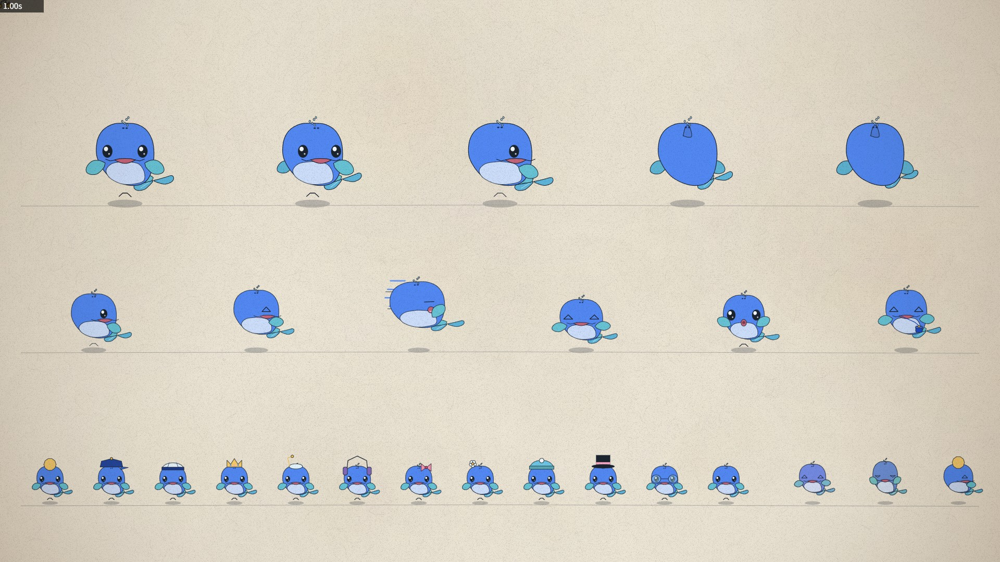

<div align="center">

# deepseek-video-skills · 深海 · 大肥鱼

<a href="README.md"></a>
<a href="README.zh-CN.md"></a>

面向 Claude Code 及兼容 Agent 的 DeepSeek 主题视频制作技能合集 —— 以“大肥鱼”为核心形象，一种视觉风格对应一个技能，
每一帧、每一个音符都由代码生成。

</div>

## 概述

每个技能都能让具备编码能力的 Agent 独立完成一种风格的完整视频：分镜、动画、审查、配乐与最终编码。所有画面与音乐均由代码
程序化生成，不依赖任何图像、视频或音频生成模型。每一帧都是时间的纯函数，在无头 Chrome 中渲染，由 ffmpeg 编码。

本仓库是 tuzhechen2005 的 [opus-video-skills](https://github.com/tuzhechen2005/opus-video-skills)（MIT）的 **DeepSeek 版**：
引擎、渲染器、工作流与结构沿用该项目；角色、配色、示范片、示例与文档为 DeepSeek 大肥鱼主题重新制作。大肥鱼是原创同人角色
（不是 DeepSeek Logo，也不是官方吉祥物）。

## 风格

| 技能 | 风格 | 典型用途 |
|---|---|---|
| [painted-animation](skills/painted-animation/README.zh-CN.md) | 以大肥鱼为主角的手绘水彩墨线动画 | 动画短片、音乐视频、带卡拉 OK 的歌词 MV |
| [kinetic-reel](skills/kinetic-reel/README.zh-CN.md) | DeepSeek 深海动态排版：窄体大标题、HUD 小字、WebGL 水层 | 产品片、Showreel、网站片头 |

### painted-animation



用 p5.js 与 p5.brush 水彩笔刷绘制每个镜头。大肥鱼拥有 39 种情绪、五张手绘关键视角、一条始终按自己节拍摆动的鲸鱼尾，以及帽子与
配件系统。示例：《最后一点深海的光》，14 秒短片（[MP4](skills/painted-animation/docs/deepsea.mp4)）：她咬开困住小鱼的贝壳，
把它一路带到水面。[文档](skills/painted-animation/README.zh-CN.md)。

### kinetic-reel


把 2D 排版画布与 three.js 图层（粒子“深海”、水光“暗流”、由一滴光弯成的鱼形标志、粒子“鱼群”）以及 WebGL 后期合成在一起。
镜头之间用形状连贯的转场，配乐与画面读取同一条时间轴。示例：《深海 · 大肥鱼》，18 秒 DeepSeek 短片
（[MP4](skills/kinetic-reel/docs/deepseek-reel.mp4)）。[文档](skills/kinetic-reel/README.zh-CN.md)。

## 环境要求

- Claude Code，或任何能读取 Skill 并执行命令、接入具备编码能力模型的 Agent（DeepSeek V4 及之后效果良好；技能本身与模型无关，
  是提示词加 Node/JS 代码）
- Node.js、Google Chrome（或 Chromium / Edge）、ffmpeg
- Python 3 及 numpy（painted-animation 的节拍检测需要）

某些显卡/驱动组合下 p5.brush 的着色器画不出东西；painted-animation 会在启动时探测并改用扁平画面渲染，视频照常输出
（没有水彩质感）。

## 安装

**以 Claude Code 插件方式安装（推荐）。** 本仓库是一个 Claude Code 插件市场清单：技能通过 Claude Code 的 `/plugin` 机制安装，
这是 Claude Code 的功能，不是 DeepSeek 官方发布的插件。在 Claude Code 中执行：

```
/plugin marketplace add feicai922/deepseek-video-skills
/plugin install painted-animation@deepseek-video-skills
/plugin install kinetic-reel@deepseek-video-skills
```

技能可只装一个或两个都装；`/plugin update` 获取新版本。（`marketplace add` 指向本版本所在的仓库；插件名分别是
`painted-animation` 与 `kinetic-reel`，市场名为 `deepseek-video-skills`。）

**作为个人技能（任意兼容 Agent）。** 克隆后链接或复制技能目录：

```bash
git clone https://github.com/feicai922/deepseek-video-skills ~/deepseek-video-skills
ln -s ~/deepseek-video-skills/skills/painted-animation ~/.claude/skills/painted-animation    # Claude Code
ln -s ~/deepseek-video-skills/skills/kinetic-reel ~/.claude/skills/kinetic-reel
# 或复制到你的 Agent 的技能目录
```

之后 `git pull` 即可更新。

> **从旧版升级。** 上一版的示例（陶喆歌词 MV、84 秒的 Work Reel ’26）原样保留在
> `examples/archived-*` / `examples/archived-opus-reels/`，并注明原作者；它们不是本版的示例。

## 使用方法

描述你想要的视频：

> 做一段 15 秒的手绘动画：大肥鱼想抓住一只泡泡。

> 为我们的模型发布会做一支 45 秒的 DeepSeek 风格动态排版短片，以演示为主。

系统会自动选择匹配的技能，也可以直接按名称调用（`/painted-animation`、`/kinetic-reel`）。技能会创建项目、提交分镜、逐个镜头
制作并审查，最终把成片写入项目的 `out/` 目录。

## 仓库结构

| 路径 | 说明 |
|---|---|
| `.claude-plugin/marketplace.json` | Claude Code 插件市场清单（每个技能一个插件） |
| `skills/painted-animation/` | 水彩动画技能：引擎、大肥鱼角色、指南、示例 |
| `skills/kinetic-reel/` | 动态排版短片技能：引擎、深海视觉体系、配乐、示例 |
| `NOTICE.md` | 第三方声明与来源说明 |
| `TESTS.md` | 测试记录：执行了什么、在什么机器上、哪些未能验证 |

新增一种风格，即在 `skills/` 下新建目录，包含 `SKILL.md`、可运行的 `template/` 和至少一个完整示例，并在
`.claude-plugin/marketplace.json` 中登记。两个现有技能遵循同一约定：每一帧都是时间的纯函数；`render.mjs` 生成关键帧拼图并
并行渲染；最终编码前，每个镜头都要依据渲染出的画面审查。

## 致谢

painted-animation 的动画引擎与指南改编自 John Heibel 的 [ClaudeAnimationBase](https://github.com/JohnHeibel/ClaudeAnimationBase)
（MIT 协议），整体方法参照其 [PDoomVideo](https://github.com/JohnHeibel/PDoomVideo)；kinetic-reel 的渲染器同样由该工具包改编而来。
两个技能最初由 tuzhechen2005 在 [opus-video-skills](https://github.com/tuzhechen2005/opus-video-skills)（MIT）中完成，本版为
DeepSeek 大肥鱼主题重做了角色模块、配色、示范片、示例、模型表与文档。项目使用 p5.js、p5.brush、three.js、Puppeteer 与 ffmpeg。
详见 [NOTICE.md](NOTICE.md)。

## 许可协议

MIT，见 [LICENSE](LICENSE)。
